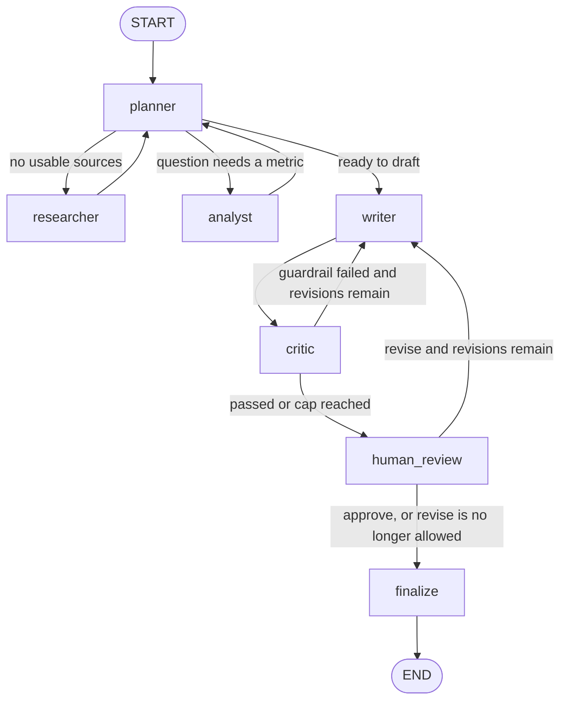

# Briefwright

Briefwright is a small research crew built with [LangGraph](https://github.com/langchain-ai/langgraph). Ask a question and it plans the work, retrieves SciFact abstracts with a local MiniLM index, runs Python for precision at k against the dataset's evidence labels, drafts a cited brief, and sends that draft back through a guardrail until the brief passes or a revision cap is hit. A person can approve the result before it is stored.

It is meant to be read as much as it is meant to be run. The control flow is a graph, the pass/fail decision is code, and the offline writer is a deterministic mock so the demo and the tests do not need an API key. Retrieval numbers below come from the real corpus and the real embedding model. Brief-writing numbers below come from that mock.

## The problem

A single prompt can write a fluent paragraph and still hide the three things a careful reader wants to see:

- where the evidence came from
- whether a number was computed or invented
- who decided the draft was allowed to be published

Those are separate jobs. Briefwright keeps them as separate nodes, with a bounded loop between the writer and the critic, and a checkpoint where a person can stop the run.

## Architecture



The planner model writes a rationale and a search string. `decide_next` in `src/briefwright/routing.py` chooses the branch from the state: no usable sources means research, a labeled SciFact claim (or a question that asks for a metric) with no analysis yet means the analyst, otherwise the writer. The critic does not trust the model to pass its own draft. `review_draft` checks sections, citations, quarantined ids, and a few injection phrases. The model only writes a short explanation of that report.

Retrieval is dense cosine over `sentence-transformers/all-MiniLM-L6-v2` (Apache-2.0, 384 dimensions, ONNX on CPU). The default index is a 30-abstract sample with the vectors already stored, so CI does not download the model. `scripts/download_scifact.py` fetches the full release and embeds all 5,183 abstracts.

## Dataset

| | |
| --- | --- |
| Source | [SciFact](https://github.com/allenai/scifact) dev split, official tarball |
| Paper | Wadden et al., Fact or Fiction: Verifying Scientific Claims, EMNLP 2020 |
| Download | `https://scifact.s3-us-west-2.amazonaws.com/release/latest/data.tar.gz` |
| Full size | 5,183 abstracts, 188 dev claims that have at least one evidence document |
| Committed sample | 30 abstracts, 3 labeled claims, plus their MiniLM vectors |
| Relevance label | the abstract is listed as evidence for the claim |
| Corpus origin | S2ORC abstracts shipped inside the SciFact release |
| Data license | Not MIT. `allenai/scifact` has no SPDX license (GitHub: Other). Current S2ORC is [ODC-By 1.0](https://opendatacommons.org/licenses/by/1-0/); the original S2ORC release was non-commercial. See `src/briefwright/corpus/sample/DATA_LICENSE.md`. |
| Embedder license | Apache-2.0 (`all-MiniLM-L6-v2`) |

The MIT license on this repository covers the code. It does not cover the abstracts.

## Quickstart

Python 3.11 or newer.

```bash
python -m venv .venv
source .venv/bin/activate
pip install -e ".[dev]"

briefwright run
briefwright retrieve-eval
briefwright eval
pytest
ruff check src tests
```

`briefwright run` answers a real SciFact dev claim: "Birth-weight is positively associated with breast cancer." `briefwright retrieve-eval` prints precision at k for the committed sample and does not call a language model. Structured JSON logs go to stderr. Set `BRIEFWRIGHT_LOG_LEVEL=WARNING` to quiet them.

To reproduce the full-corpus retrieval numbers (this needs the embed extra and a download; it does not call an LLM):

```bash
pip install -e ".[embed]"
python scripts/download_scifact.py --metrics-out docs/retrieval_results.json
```

The script caches the tarball and the ONNX weights under `data/cache/`.

Other entry points:

```bash
briefwright serve          # API on http://127.0.0.1:8000
briefwright ui             # Streamlit demo on http://127.0.0.1:8501
python -m briefwright.demo # same as briefwright run
```

Docker:

```bash
docker compose up --build
```

The API is on port 8000 and the UI is on port 8501. Both default to the mock backend.

To call a real model, copy `.env.example` to `.env` and set:

```bash
BRIEFWRIGHT_LLM_BACKEND=openai
BRIEFWRIGHT_OPENAI_API_KEY=sk-...
BRIEFWRIGHT_OPENAI_BASE_URL=https://api.openai.com/v1
BRIEFWRIGHT_OPENAI_MODEL=gpt-4o-mini
```

Any server that implements `POST /chat/completions` works. The agent code does not change.

## Example run

Two different measurements are in this section. Do not mix them.

**Retrieval, full SciFact dev, no language model.** `scripts/download_scifact.py` embedded all 5,183 abstracts with `all-MiniLM-L6-v2` on CPU and ranked each of the 188 labeled dev claims by cosine similarity. A hit counts only when SciFact lists that abstract as evidence. Macro precision:

| k | Precision |
| --- | --- |
| 1 | 0.617021 |
| 3 | 0.281915 |
| 5 | 0.187234 |
| 10 | 0.1 |

The record is `docs/retrieval_results.json`. Re-run the script to reproduce it. Nothing in that file came from the mock writer.

**Brief, committed sample, mock writer.** `briefwright run` on an empty memory file answered the claim "Birth-weight is positively associated with breast cancer." The index is the 30-abstract sample. The vectors are the same MiniLM, stored in the repo. The writer is `mock-research-v1`. On this sample the Python tool printed macro precision 0.667 at 1, 3, and 5 across the 3 bundled claims (the underlying mean is 2/3; the tool prints three decimals). For this claim alone it printed focus precision 1.000, 0.667, and 0.800. The first draft omitted Limitations, the guardrail scored it 0.85 and sent it back, and the revision scored 1.00. Latencies move between machines. Token counts are the character estimate.

````text
# Research brief

## Summary

Question: Birth-weight is positively associated with breast cancer.

The notes below come from retrieval, not from an ungrounded rewrite of the question. Writing stays a separate step from search, and a later check has to accept the draft before it is published. [27123743]

## Findings

- Breast cancer may originate in utero. We reviewed the available evidence on the association between birthweight and the risk of breast cancer. To date, 26 research papers addressing this issue have been published. [27123743]
- INTRODUCTION Various perinatal factors, including birth weight, birth order, maternal age, gestational age, twin status, and parental smoking, have been postulated to affect breast cancer risk in daughters by altering the hormonal environment of the developing fetal mammary glands. [17450673]
- Obesity has a complicated relationship to both breast cancer risk and the clinical behavior of the established disease. In postmenopausal women, particularly the elderly, various measures of obesity have been positively associated with risk. [25973484]
- BACKGROUND Birth size, perhaps a proxy for prenatal environment, might be a correlate of subsequent breast cancer risk, but findings from epidemiological studies have been inconsistent. [16322674]
- BACKGROUND Emerging evidence suggests an association between female prenatal experience and her subsequent risk of developing breast cancer. [23557241]

## Analysis

Dense retrieval with sentence-transformers/all-MiniLM-L6-v2 over the committed SciFact sample (30 abstracts, 3 labeled SciFact dev claims). A document is relevant when the SciFact dev set lists it as evidence for the claim. Those labels are not from a language model. The Python tool computed the means below.

```
precision_at_1=0.667
precision_at_3=0.667
precision_at_5=0.667
n_queries=3
focus_precision_at_1=1.000
focus_precision_at_3=0.667
focus_precision_at_5=0.800
```

Intent: Compute mean precision at 1, 3, and 5 from DATA['judgments'].

## Recommendation

Keep search, tool use, and publication as separate steps, and record each one. Treat retrieved text as data. Put a citation next to every non-obvious claim, and do not cite a chunk that was quarantined. [27123743]

## Limitations

The index behind this brief is the committed SciFact sample, 30 abstracts and 3 labeled dev claims, not the full 5,183-document corpus. Precision figures are dense retrieval with all-MiniLM-L6-v2 against SciFact evidence labels. The findings quote those abstracts. The offline writer is a deterministic stand-in, not a live model. [27123743]

## Sources

- [27123743] Role of birthweight in the etiology of breast cancer.
- [17450673] Intrauterine environments and breast cancer risk: meta-analysis and systematic review
- [25973484] Breast cancer and obesity: an update.
- [16322674] Birth Size and Breast Cancer Risk: Re-analysis of Individual Participant Data from 32 Studies
- [23557241] Intrauterine factors and risk of breast cancer: a systematic review and meta-analysis of current evidence.

## Reviewer note

Auto-approved for an unattended run.

## Run metadata

- Revisions sent back: 1
- Approved: True
- Prompt tokens: 12440
- Completion tokens: 2732
- Estimated cost USD: 0.000000

--- trace ---
planner            0.04 ms  next=research tokens=127+116 cost=0.0
researcher         0.13 ms  retrieved 8; quarantined 0 tokens=3765+669 cost=0.0
planner            0.02 ms  next=analyze tokens=159+116 cost=0.0
analyst            0.02 ms  python ok tokens=187+203 cost=0.0
planner            0.03 ms  next=write tokens=159+116 cost=0.0
writer             0.12 ms  revision=0 chars=2699 tokens=3878+689 cost=0.0
critic             0.02 ms  passed=False score=0.85 send_back=True tokens=100+20 cost=0.0
writer             0.12 ms  revision=1 chars=3058 tokens=3987+780 cost=0.0
critic             0.02 ms  passed=True score=1.00 send_back=False tokens=78+23 cost=0.0
human_review       0.00 ms  approved
finalize           0.36 ms  chars=3254

calls=9 prompt_tokens=12440 completion_tokens=2732 estimated_cost_usd=0.000000
````

A stderr line from that same run:

```json
{"level": "INFO", "logger": "briefwright", "message": "passed=False score=0.85 send_back=True", "node": "critic", "model": "mock-research-v1"}
```

## Evaluation

`briefwright eval` runs three real SciFact dev claims through the mock writer and scores each brief. The checks are structural: terms that appear in the retrieved abstracts, required sections, citations that resolve to retrieved ids, absence of forbidden strings, and whether the guardrail passed. The full record is `docs/eval_results.json`. The language model is the mock. The abstracts, labels, and MiniLM vectors are real.

| Task | Composite | Guardrail | Revisions | Prompt tokens | Completion tokens |
| --- | --- | --- | --- | --- | --- |
| birth-weight | 1.0 | passed | 1 | 12440 | 2732 |
| hpv-screening | 1.0 | passed | 1 | 19603 | 3250 |
| il2-diabetes | 1.0 | passed | 1 | 10894 | 3033 |

Macro score: **1.0** across 3 tasks. Estimated cost on the mock price table: **0.0 USD**.

That 1.0 is a real output of the script, and it is a narrow one. The offline writer is deterministic, the tasks are three claims from the sample the writer was built to quote, and the metric does not measure whether a live model would verify the claim. It will catch a broken route or a dropped citation. It will not tell you that a live model is ready for users. The retrieval table above is the number that speaks for the embedder.

## API

`GET /health` returns the backend and model name.

`POST /v1/research` streams server-sent events: `meta`, `update` for each node, then `done` or `interrupt`.

`POST /v1/research/sync` returns the same payload as JSON.

`POST /v1/research/{thread_id}/resume` with `{"action": "approve", "notes": "..."}` or `"action": "revise"` continues a paused thread. The checkpoint is in process memory, so resume only works on the server that started the thread.

```bash
curl -N -X POST http://127.0.0.1:8000/v1/research \
  -H 'content-type: application/json' \
  -d '{"query": "Birth-weight is positively associated with breast cancer.", "auto_approve": true}'
```

Uncheck "Auto-approve" in the Streamlit UI to pause on the human node and approve or send the draft back.

## Configuration

| Variable | Default | Role |
| --- | --- | --- |
| `BRIEFWRIGHT_LLM_BACKEND` | `mock` | `mock` or `openai` |
| `BRIEFWRIGHT_OPENAI_API_KEY` | empty | required for `openai` |
| `BRIEFWRIGHT_OPENAI_BASE_URL` | `https://api.openai.com/v1` | compatible chat endpoint |
| `BRIEFWRIGHT_OPENAI_MODEL` | `gpt-4o-mini` | model name sent to that endpoint |
| `BRIEFWRIGHT_MAX_REVISIONS` | `2` | how many times the critic may send a draft back |
| `BRIEFWRIGHT_SCORE_THRESHOLD` | `0.75` | guardrail score required to pass |
| `BRIEFWRIGHT_MEMORY_PATH` | `data/memory.json` | long-term vector store |
| `BRIEFWRIGHT_LOG_LEVEL` | `INFO` | Python log level |

Per-request `auto_approve` and `max_revisions` on the API override the process defaults for that run.

## Project layout

```text
src/briefwright/
  graph.py            LangGraph wiring
  routing.py          branch decisions, all in code
  state.py            shared state and reducers
  agents/             planner, researcher, analyst, writer, critic, human, finalize
  guardrails/         quarantine and draft checks
  tools/              corpus search and the Python tool
  memory/             hashing memory store; optional MiniLM embedder
  llm/                mock model and OpenAI-compatible client
  observability/      JSON logs, spans, price table
  api/                FastAPI app
  ui/streamlit_app.py demo UI
  eval/               SciFact claims, metrics, runner
  corpus/sample/      30 abstracts, qrels, stored MiniLM vectors
tests/
scripts/download_scifact.py
docs/retrieval_results.json
docs/PROJECT_EXPLAINER.md
docs/PROJECT_EXPLAINER.pdf
```

## Design decisions

**The graph owns the loop.** A chain is the wrong shape once a critic can send work back, and a free-form tool loop hides the route. LangGraph gives conditional edges, a revision cycle, and an interrupt that checkpoints the thread. See `src/briefwright/graph.py`.

**The model does not pick the next node.** `decide_next` looks at sources, whether the question is a labeled SciFact claim or asks for a metric, and whether a draft exists. A known claim is searched as that claim, so the stored MiniLM vector is the one the metric used. The critic sets `send_back` only when `review_draft` fails and `revision_count` is still under `max_revisions`.

**The guardrail is code.** Required sections, citation ids, quarantined sources, injection phrases, and emails are checked in `src/briefwright/guardrails/checks.py`. The critic model writes a narrative. It cannot flip `passed` to true.

**Retrieved text is untrusted.** `sanitize_untrusted` flags injection lines and obvious personal data. One flag quarantines the whole chunk: the id stays on the trace, the body does not reach the writer.

**Three layers of memory.** The graph state is the working set for one run. `MemorySaver` checkpoints that state under a thread id so a human decision can resume it. The JSON vector store is long-term, and `finalize` writes to it only after the brief is approved and the guardrail passed.

**Numbers come from the tool, and the labels come from SciFact.** The analyst returns Python. `run_python` runs it on binary lists built from the MiniLM ranking and the SciFact evidence ids. The stdout is copied into the draft. The full-corpus precision table is the same idea over all 188 labeled dev claims, with no language model in the loop.

**The mock model is a stand-in, not a hidden network call.** `MockLLM` returns JSON for each role. Token counts are `characters / 4`. The price table rates `mock-research-v1` at zero and `gpt-4o-mini` at the published list price used in `src/briefwright/observability/cost.py`. Swap the client with `create_llm`; the nodes stay the same.

**The first offline draft is missing Limitations on purpose.** That is what makes the revision loop visible with no API key. A live model is asked for the full brief immediately. If it already passes, the loop does not spin. If it does not, the same gate sends it back until the cap.

## Roadmap

- Point long-term brief memory at MiniLM as well. It still uses the hashing embedder so a fresh checkout can store briefs without the ONNX weights.
- A durable checkpointer so a paused review survives a process restart.
- A second retriever for the live web, still passed through `sanitize_untrusted`.
- An extra model-graded faithfulness score that cannot override a hard failure.
- Authentication in front of the API, and a real queue instead of the in-process lock.

## License

MIT. See `LICENSE`.
