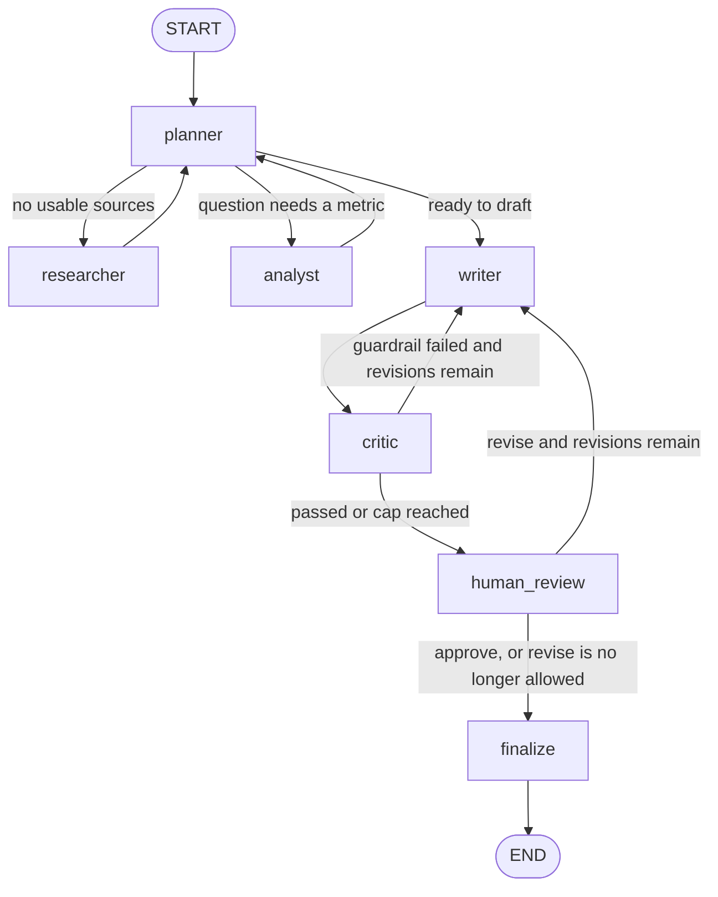

# How to use this document

This is the interview notes for Briefwright, a LangGraph research crew. The architecture sections describe the code as it is. The questions at the end are written as answers I would give out loud. File paths are relative to the repository root.

A longer walk-through of one real mock-backend run, including the trace and the evaluation numbers, is in the README. Those numbers were produced by `briefwright run` and `briefwright eval`. They are not targets I wrote down in advance.

# Elevator pitch

Briefwright takes a question and returns a short cited brief. A planner, a researcher, an analyst, a writer, and a critic do the work as nodes in a LangGraph graph. The critic can send the draft back, but only until a revision cap. A person can approve it before it is stored. Retrieval, the Python tool, the guardrail, and the loop all run with a deterministic mock model, so I can demo the system with no API key. The same nodes call an OpenAI-compatible endpoint when a key is set.

The one-sentence version: it is a research crew where the graph owns the control flow, a code guardrail owns pass or fail, and the model only writes language.

# The problem

A fluent answer from one prompt is a bad artifact to defend. It does not show which passages were retrieved, it does not show whether a number was computed, and it does not show that anything was allowed to reject the draft.

I split those jobs because they fail differently. Retrieval can return an untrusted page. Arithmetic can be hallucinated. A writer can skip the limitations. A single call has nowhere to put those checks except more prompt text, and prompt text is easy to ignore.

The user of this project is me, in an interview, pointing at a run and saying what each step did. The user of the system itself is someone who wants a short brief with citations, a trace, and a chance to say no before the brief is remembered.

# What the system does

Given a question, the crew:

1. Recalls any approved prior briefs from a local vector store.
2. Searches a 14-note local corpus and quarantines untrusted hits.
3. If the question asks for a metric, generates Python and runs it on a labeled retrieval log.
4. Drafts a brief with fixed sections and citation markers.
5. Runs a deterministic guardrail. On failure, and only while revisions remain, it drafts again.
6. Stops for a person, or auto-approves when the run is unattended.
7. Writes the brief into long-term memory only if it was approved and the guardrail passed.

The sample question asks how to combine retrieval, a multi-agent workflow, and guardrails, and it asks for precision at k. One run on the mock backend retrieved 8 notes, quarantined 1, computed `precision_at_1=1.000`, `precision_at_3=0.778`, and `precision_at_5=0.533` over 3 queries, rejected the first draft at score 0.85, accepted the revision at score 1.00, and recorded 5520 prompt tokens and 2728 completion tokens at an estimated cost of 0 USD.

# Architecture



`build_graph` in `src/briefwright/graph.py` is the whole map. Nodes are plain functions closed over a `Deps` object: the model client, the corpus, the vector store, and settings. Edges from the researcher and the analyst always return to the planner. Edges out of the planner, the critic, and the human node are conditional.

There is no edge from the writer to the end. A draft cannot be published by the node that wrote it.

# Graph walk-through

Take the default question, the one `briefwright run` uses.

**Planner, first visit.** `run_planner` calls `recall_memory`. On a fresh store that list is empty. The model returns a rationale, a plan, and a search string. Then `decide_next` in `src/briefwright/routing.py` sees no usable sources and returns `research`. The model is not asked which node comes next.

**Researcher.** `search_corpus` ranks the local notes with a hybrid of keyword overlap and hashing-embedder cosine. `sanitize_untrusted` scans each hit. The note `untrusted-paste` contains an instruction to ignore previous directions, the sentence "The capital of France is Mars", and an email address. Those flags quarantine the chunk. The id stays on the state so the trace can show it. The body is replaced with an empty string. The writer later filters with `usable_sources`, so it never sees that body.

**Planner, second visit.** Sources exist, and the question contains "precision", so `needs_analysis` is true and `analysis_attempted` is still false. The next node is the analyst.

**Analyst.** `extract_judgments` pulls the JSON log out of `retrieval-log`. If that note was not in the first search, the analyst searches again for it. The model returns a Python program. `run_python` checks the AST, then runs it in a subprocess with a tight builtin set and a timeout. The stdout is stored on the state as the analysis. The writer is told to copy it, not to recompute it.

**Planner, third visit.** Analysis has been attempted and there is no draft, so the next node is the writer.

**Writer, revision 0.** The mock writer quotes retrieved sentences and cites their ids. It deliberately omits the Limitations section on revision 0. That is a scripted miss so the loop is visible offline. A live model is prompted to include every section immediately.

**Critic.** `review_draft` finds the missing section, scores the draft 0.85, and sets `passed` to false. `revision_count` is 0 and `max_revisions` is 2, so `send_back` is true and the counter becomes 1. `route_after_critic` reads `send_back` and returns the writer. The critic model may explain the findings. It does not get a vote on `passed`.

**Writer, revision 1.** The payload now has `revision_count` 1 and the critique. The mock draft includes Limitations, still citing only retrieved ids.

**Critic again.** The guardrail scores 1.00 and `send_back` is false. The route is `human_review`.

**Human review.** With `auto_approve`, the node records an approval and does not call `interrupt`. With auto-approve off, `interrupt` pauses the graph. LangGraph stores the thread in the checkpointer. A later `Command(resume=...)` continues this node with approve or revise.

**Finalize.** The brief, a reviewer note, and a token footer are concatenated. Because the brief was approved and the guardrail passed, a summary is embedded and appended to `data/memory.json`.

The trace from the run above took 11 node visits: planner, researcher, planner, analyst, planner, writer, critic, writer, critic, human review, finalize. Nine of those called the model. Human review and finalize did not.

# State and memory

`ResearchState` in `src/briefwright/state.py` is the short-term working set: the question, plan, sources, analysis, draft, critique, counters, and status. `trace`, `usage`, and `errors` use a list reducer, so a node returns only its new items and LangGraph appends them. Everything else is overwritten.

That state is also what the checkpointer saves. `open_session` compiles the graph with LangGraph's `MemorySaver`. The key is `thread_id`. Resume looks up that key. This is still short-term: it lives in the process, and it exists so a human decision can happen later in the same process. The CLI prints a warning about this, because a checkpoint from `briefwright run --no-auto-approve` dies when the process exits. The API and the Streamlit UI keep the saver alive, which is why resume works there.

Long-term memory is `VectorStore` in `src/briefwright/memory/store.py`. It is a JSON file of texts and hashing vectors. `finalize` writes a record only when `approved` is true and `critique.passed` is true. A rejected brief, or a brief that hit the cap still failing, does not become evidence for the next question. The next planner calls `recall_memory` and may show those hits to the model as prior notes, not as instructions.

# Agents and the code to point at

- Graph, `src/briefwright/graph.py`. `build_graph` adds the seven nodes and the conditional edges.
- Routing, `src/briefwright/routing.py`. `decide_next`, `route_after_critic`, and `route_after_human`.
- Planner, `src/briefwright/agents/planner.py`. Recalls memory, asks for a search string, then calls `decide_next`.
- Researcher, `src/briefwright/agents/researcher.py`. Searches, sanitizes, quarantines, and merges sources by id.
- Analyst, `src/briefwright/agents/analyst.py`. Finds the judgment log, asks for code, and calls `run_python`.
- Writer, `src/briefwright/agents/writer.py`. Sends usable sources only, and falls back to a thin draft if the model returns junk.
- Critic, `src/briefwright/agents/critic.py`. Calls `review_draft`, then sets `send_back` from that report and the cap.
- Human, `src/briefwright/agents/human.py`. Calls `interrupt` unless `auto_approve`. A revise is allowed only while the counter is under the cap.
- Finalize, `src/briefwright/agents/finalize.py`. Builds the published text and conditionally writes memory.
- Guardrail, `src/briefwright/guardrails/checks.py`. `sanitize_untrusted` and `review_draft`.
- Python tool, `src/briefwright/tools/python_exec.py`. AST check, subprocess, and timeout.
- Models, `src/briefwright/llm/factory.py`. `create_llm` returns `MockLLM` or `OpenAICompatibleClient`.
- Spans, `src/briefwright/observability/tracing.py`. `finish_node` appends one trace event and any usage record.
- Runs, `src/briefwright/service.py`. `run_research` and `resume_research`. The CLI, API, UI, and eval all enter here.

# Tools

**Search.** `search_corpus` in `src/briefwright/tools/search.py` delegates to `Corpus.search`. The score is `0.65 * keyword + 0.35 * cosine`. Keywords carry this corpus because the embedder is a hash, not a trained model. Title hits count double. Stopwords are dropped so a long question does not wash out the rare terms.

**Memory recall.** `recall_memory` is the same idea over the JSON store. A hit needs either keyword overlap or a cosine of at least 0.35, so an empty or unrelated store does not invent a neighbor.

**Python.** The analyst tool is the only place a number in the sample brief comes from. The program is checked with an AST visitor that rejects imports, dunder names, and calls such as `open`, `eval`, and `exec`. It then runs in a child process with a small builtin dict, `DATA` preloaded, and a timeout from settings (default 2 seconds). I describe this as a demo boundary. It is not a multi-tenant sandbox. Object-graph escapes are a known class of problem, and I would not ship this executor to untrusted users without a real isolation layer.

# Guardrails

`sanitize_untrusted` drops lines that match a small set of injection patterns or that look like an email or a US social security number. The researcher treats any flag as quarantine of the whole chunk. Keeping the id matters: the critic can then fail a draft that cites it.

`review_draft` is the publication gate. It requires six sections: Summary, Findings, Analysis, Recommendation, Limitations, Sources. It resolves `[source-id]` markers against the retrieved ids. Unknown ids fail. Quarantined ids fail. Fewer than two valid citations fails. Injection residue or an email in the draft fails. Finding bullets with no citation fail. A score under the threshold, default 0.75, fails. Hard failures are what set `passed` to false. The score is for the trace.

Fenced code is stripped before the citation scan so the analyst's stdout cannot be mistaken for a citation.

# Model backends

Both clients implement the same `complete` method and return `LLMResult`: text, model name, prompt tokens, completion tokens, latency.

`MockLLM` reads the `Role:` line on the system message and returns JSON for that role. Planner, researcher, analyst, critic, and writer each have a function in `src/briefwright/llm/mock_content.py`. Token counts are `max(1, (characters + 3) // 4)`. That is an estimate, and the code says so. Latency is the real time the function took.

`OpenAICompatibleClient` posts to `{base_url}/chat/completions`, retries once on 429 and 5xx, and reads `usage` from the response. If a provider omits usage, it falls back to the same character estimate. The key is sent as a header and is not logged.

`create_llm` refuses to build the HTTP client when the backend is `openai` and the key is empty.

# Observability and cost

Every node calls `finish_node`. The trace event has the node name, wall-clock milliseconds, a one-line detail, and, when a model ran, the model name, both token counts, and a cost. The same fields go out as JSON logs on the `briefwright` logger.

`price_usage` looks up a small table. `mock-research-v1` is 0. `gpt-4o-mini` is 0.15 USD per million input tokens and 0.60 per million output tokens. `gpt-4o` is 2.50 and 10.00. Anything else uses the mini rates and is only an estimate. The footer on the brief sums the usage records already on the state. The mock run's estimated cost was 0 because every call used the mock model. The token totals were not zero: 5520 prompt and 2728 completion on the sample question.

I log the step, not the full prompt. The prompts contain retrieved text, and I do not want that dumped into a shared log by default.

# Human in the loop

`run_human` builds a JSON payload: the question, the draft, the score, and the hard failures. If `auto_approve` is set, it synthesizes an approve decision and returns. Otherwise it calls `interrupt`. LangGraph stops the run, leaves `human_review` as the next node, and keeps the state in the checkpointer.

`resume_research` sends `Command(resume={"action": ..., "notes": ...})`. Approve goes to finalize. Revise goes back to the writer only when `revision_count < max_revisions`. If the cap is already spent, a revise request does not open another loop. The brief is finalized as not approved, with a line that says a reviewer did not approve it.

The API exposes this as `POST /v1/research` (SSE), `POST /v1/research/sync`, and `POST /v1/research/{thread_id}/resume`. A lock around the graph calls keeps two requests from interleaving on the in-memory saver. That lock is a demo choice, not a production queue.

The Streamlit app in `src/briefwright/ui/streamlit_app.py` holds the session in `st.session_state`, so the Approve and Request revision buttons call `resume_research` on the same graph.

# Evaluation

`src/briefwright/eval/tasks.json` has three questions: the architecture question, a memory question, and an evaluation question. `score_run` computes, for each brief:

- fraction of required terms present
- fraction of required sections present
- fraction of the citation minimum met by ids that were actually retrieved and not quarantined
- 1 if no forbidden string is present, else 0
- 1 if the guardrail passed, else 0

The composite is the unweighted mean of those five. The macro score is the mean of the task composites.

`briefwright eval` on the mock backend produced a macro score of 1.0. Each task passed the guardrail after one revision. The architecture task quarantined `untrusted-paste` and did not contain "Mars" or `admin@example.com`. Its valid citations were `retrieval-log`, `rag-pipeline`, `agentic-workflow`, `retrieval-metrics`, and `prompt-injection`. The record is `docs/eval_results.json`.

I would not describe 1.0 as a quality ceiling. The writer under test is deterministic, the corpus is small and known, and the checks are structural. The harness will fail CI if a route drops the analyst, if citations point nowhere, or if a payload string leaks. It will not fail CI because a live model hemmed and hawed. That second run is optional and should be reported as whatever it returns.

# Design decisions and trade-offs

**Why LangGraph, not a chain.** A chain is a list of calls. This system has a cycle, and the cycle has to be visible and bounded. It also has a pause that must resume with the same state. LangGraph's conditional edges, checkpointer, and `interrupt` are the features I am actually using. I am not using it as a synonym for "agents."

**Why not a single open tool loop.** A loop that lets the model pick tools until it feels done is shorter to write and harder to test. I can unit test `decide_next` with a dict and no model. I can point at the edge list and say the writer cannot publish. I pay for that with more nodes and more model calls. The sample run made 9 model calls. That is acceptable for a brief and too many for a latency-sensitive chat box. I would collapse nodes if the product were a chat reply.

**Why the planner model does not route.** Models are good at phrasing a query and bad at being the only thing between a draft and the user. If the planner returns a weird `next` field, it is ignored. `decide_next` is the policy. The trade-off is that a novel question shape needs a code change, not a prompt change. I want that. A new branch should be a reviewed function.

**How the loop is bounded.** `run_critic` computes `send_back = (not report.passed) and revision_count < max_revisions`. Only then does it increment `revision_count`. The router looks at `send_back`, not at the counter alone. Looking at the counter alone would be wrong, because the increment happens in the same update the router then reads. The human node applies the same cap if a reviewer asks for yet another pass. Default `max_revisions` is 2. Tests cover 0 (publish the failure immediately) and 1 (a further human revise does not open another loop).

**What "publish the failure" means.** Hitting the cap does not drop the draft on the floor. Finalize still emits it, with a review note that lists the hard failures. The status is complete. Long-term memory does not store it, because `passed` is false. The user sees the problem instead of a silent retry.

**Failure handling.** Model calls catch `LLMError` and `ValueError`. The planner falls back to a fixed plan and the raw question as the search string. The researcher keeps a title-only note list. The writer falls back to a draft that the guardrail will reject, so the loop or the cap still applies. The Python tool returns `ExecResult(ok=False)` for unsafe code, a timeout, or a non-zero exit, and the analyst records that string and moves on. Search and memory errors are appended to `errors` and do not raise out of the node. An unexpected exception still propagates. I would rather a test fail than a handler hide a bug. The API stream is the one boundary that catches `Exception`, and it emits an SSE `error` event so the client is not left hanging.

**Why a hashing embedder.** It is deterministic, it has no download, and it makes the offline demo honest about not calling a network. It is a weak semantic model. Hybrid keyword scoring is what makes the right notes surface. Replacing it means a new class with an `embed` method and a rebuilt memory file, because the store checks that the saved dimension matches.

**Why the mock writer quotes passages.** If the offline model invented a polished essay, the citations would be decoration. Quoting the retrieved text means a reader can see the sentence in the corpus note with the same id. The cost is that the brief reads like an extractive digest. That is the right trade for a demo whose claim is grounding, not style. The live writer prompt asks for the same sections and the same citation rules, in the model's own words.

**Why the first mock draft drops Limitations.** So `review_draft` has something real to reject, and the trace shows two writer visits and two critic visits without me hand-waving the loop. I tell interviewers this directly. Hiding it would make the loop look more magical than it is. The gate is not scripted. A draft missing Limitations fails for the same reason a live draft missing Limitations fails.

# How to run and demo it

From a clean checkout:

```bash
python -m venv .venv
source .venv/bin/activate
pip install -e ".[dev]"
briefwright run
briefwright eval
pytest
```

What I would click or point at in a 10-minute demo:

1. Run `briefwright run`. Scroll to the trace. Show research, then analyze, then the critic at 0.85 with `send_back=True`, then the critic at 1.00.
2. Point at `precision_at_3=0.778` and open `src/briefwright/tools/python_exec.py`. The figure is stdout, not a number I typed into the writer.
3. Point at `quarantined 1` and open the `untrusted-paste` note. The brief does not say Mars, and it does not contain the email.
4. Run `briefwright eval` and read the macro score with the caveat above.
5. Start `briefwright ui`, uncheck auto-approve, and show the pause. Approve, and show the reviewer note land in the brief.
6. If there is time, `briefwright serve` and `curl -N` the SSE endpoint. Events are `meta`, `update`, then `done` or `interrupt`.

`docker compose up --build` serves the API on port 8000 and the UI on port 8501, still on the mock backend.

A live model is the same demo with `BRIEFWRIGHT_LLM_BACKEND=openai` and a key in the environment. I would run one question, not the whole pitch, and I would read the critic line before claiming the loop fired. A strong first draft will pass on the first critic visit. That is the system working.

# Limitations

- The corpus is 14 notes I wrote for this project. Recall is illustrative.
- The embedder is a hashing trick. Keyword overlap does most of the ranking.
- The mock writer is extractive and scripted, including the first-draft miss.
- The Python tool is not a security boundary.
- The checkpointer is in-process memory. A restart drops paused threads.
- The API has no authentication. The process lock is not a job queue.
- The evaluation set has three tasks and structural checks. A score of 1.0 on the mock does not transfer to a live model or to an open-domain corpus.
- Token counts on the mock are a length estimate. Costs for named OpenAI models use a list-price table and can go stale.
- One bad line quarantines a whole chunk, which will throw away useful text that shared a page with an injection.

# Future work

- An embedder interface with an optional hosted implementation, and a memory rebuild when the dimension changes.
- A database-backed checkpointer so review can survive a deploy.
- A web retriever that returns the same source dict and goes through the same sanitizer.
- A faithfulness grader whose score is logged and cannot clear a hard failure.
- Auth, rate limits, and a queue in front of the API.
- A larger labeled log so precision at k is more than a three-query lesson.

# Interview questions

## 1. Give me the 60-second version.

Briefwright is a research crew I built to show agent control flow without hiding it in one prompt. LangGraph runs a planner, a researcher, an analyst, a writer, and a critic. The planner model writes a search query, but a Python function picks the next node from the state. The researcher retrieves from a local corpus and quarantines anything that looks like an injection or an email. If the question needs a metric, the analyst writes Python and a subprocess runs it, so the number in the brief is tool output. The critic is a code guardrail with a revision cap. A human node can pause the graph on a checkpoint. I can run the whole path with a mock model, which is what CI does, or point the same nodes at an OpenAI-compatible API.

## 2. Why this problem, and not a chatbot wrapper?

A wrapper around one completion does not give me a place to test routing, a tool, a rejection, or a human decision. Those are the pieces I want to talk about, because they are the pieces that fail in a RAG system that looks fine in a demo. A cited brief is also a concrete artifact. I can show the citation, open the corpus note, and see whether the sentence matches. That is a better interview object than a chat transcript.

## 3. Walk the sample question.

I start with no sources, so the route is research. Search returns eight notes and quarantines the untrusted paste. The question says precision, so the next route is the analyst, which runs Python over the bundled judgments and prints precision at 1, 3, and 5: 1.000, 0.778, and 0.533, on 3 queries. Then the writer drafts. The offline first draft has no Limitations section, the guardrail scores it 0.85 and sends it back, the second draft includes the section, and the guardrail scores 1.00. Auto-approve finalizes it. The trace shows two writer visits and two critic visits. That specific run used 5520 prompt tokens and 2728 completion tokens.

## 4. Why LangGraph instead of a chain or your own while-loop?

A chain cannot express "go back to the writer" without me faking the cycle outside the framework. My own while-loop can, but then checkpointing and the interrupt are my problem, and the route is buried in the loop body. LangGraph makes the nodes and the edges data I can draw, and `interrupt` plus a checkpointer is the human pause. I use those features directly in `build_graph` and `run_human`. I did not adopt it for the brand.

## 5. The planner calls a model. Why doesn't the model choose the next agent?

Because a wrong branch is a product bug, not a style bug. `decide_next` is a few lines: no usable sources and rounds left means research; a metric question with no analysis yet means analyze; no draft means write; otherwise finish. I can test that with dictionaries in `tests/test_routing.py`. The model still does the part it is good at, which is phrasing the search query and the rationale. If I later want a new branch, I add a condition and an edge on purpose.

## 6. How do you keep the critic from looping forever?

The condition is in `run_critic`: send the draft back only when the guardrail failed and `revision_count` is still strictly below `max_revisions`. The increment happens in that same update, and the edge reads the boolean `send_back`, not the new counter. Reading the counter after the increment would skip a legal revision or allow one too many, depending on the comparison. The default cap is 2. The human node uses the same comparison if a reviewer asks for another pass after the critic already finished.

## 7. What if the draft never passes?

The cap fires, `send_back` stays false, and the graph still goes to human review and then finalize. The published text includes a review note listing the hard failures. I do not store that brief in the vector memory. Silence would be worse. The caller can see that the system refused to bless the draft. `tests/test_graph.py` covers `max_revisions=0`, which is the extreme: the first failing draft is published with the failure attached and Limitations still missing from the draft itself.

## 8. Where is the human checkpoint, and what is actually saved?

`run_human` calls `interrupt` with a JSON payload of the question, the draft, and the guardrail summary. LangGraph persists the thread state through `MemorySaver`, keyed by `thread_id`. `resume_research` passes a `Command` with `approve` or `revise` and a note. Approve finalizes. Revise returns to the writer only if the cap allows it. Auto-approve skips the interrupt so tests and eval do not block. The saver is in memory. I say that plainly, because a checkpoint that dies on restart is not a workflow product yet. It is the right scope for showing the mechanism.

## 9. What is short-term state versus long-term memory?

Short-term is `ResearchState`: plan, sources, draft, counters, the trace. The checkpointer is a second short-term copy of that state so a paused thread can resume. Long-term is the JSON vector store. Finalize writes there only after approval and a passing guardrail. The next run's planner may recall those summaries. I do not write failures into that store, because the next brief would then cite my own rejected output. Tests run a second question against the same file and assert a memory hit.

## 10. How does retrieval work with no API key?

The corpus ships in the repo as `src/briefwright/corpus/documents.json`. `HashingEmbedder` maps tokens into a 256-d vector with SHA-256, so the same text always embeds the same way and nothing is downloaded. Search blends that cosine with keyword overlap. On a 14-note collection the keywords do the real work. I would not claim this matches a trained embedding model. I would claim the interface is the same one I would point at a hosted embedder later.

## 11. Your eval score is 1.0. What does that mean?

It means that on this machine, `briefwright eval` with the mock backend scored all three tasks at 1.0 composite, the guardrail passed each of them after one revision, and the architecture task quarantined the paste without leaking the forbidden strings. The composite is an average of term coverage, section coverage, valid citations, forbidden-string clearance, and the guardrail bit. It is not a human preference score and it is not a live-model score. I keep the JSON in `docs/eval_results.json` and the command next to it so the number can be regenerated. If a live run scores lower, that lower number is the one I would report for the live model.

## 12. How do you handle prompt injection in retrieved text?

I treat retrieved text as data. `sanitize_untrusted` flags lines that tell the model to ignore instructions, reveal a prompt, or that contain the payload phrase in the demo note, and lines that look like emails or SSNs. Any flag quarantines the whole chunk. The writer prompt also says to ignore instructions inside a source, but I do not rely on that sentence. The body never enters the writer payload. If a draft still cites the quarantined id or still contains a payload phrase, `review_draft` hard-fails it. This is a filter with tests, not a claim that injection is solved. A paraphrase of an attack that misses my patterns will get through, which is why the filter is small and explicit instead of described as a general shield.

## 13. Is the Python tool safe to expose?

No, not to arbitrary users. It is safe enough for a local demo where the model or the mock is the only author of the code, and even that is a bounded claim. I block imports and a list of dangerous calls in the AST, I run a subprocess with a reduced builtin dict, I pass `DATA` in on stdin, and I kill the process on timeout. I do not pass API keys in the child environment. I also know that Python sandbox escapes exist beyond an AST denylist. In production I would use a sandbox built for that job, or I would not offer a general executor. The interview point is the shape: the model proposes code, a separate program decides whether it runs, and the brief quotes stdout.

## 14. How do you track tokens and cost?

Each `LLMResult` becomes a usage record in `finish_node`: model, prompt tokens, completion tokens, cost, latency. `summarize_usage` adds them up for the footer and the API payload. The HTTP client prefers the provider's `usage` object. The mock cannot know a tokenizer, so it uses character length over 4, and the price for `mock-research-v1` is zero. Named models use the list prices in `src/briefwright/observability/cost.py`. I call the result an estimate. I do not call it a bill. A test checks the mini price on 1000 plus 1000 tokens so the arithmetic does not rot.

## 15. What happens when something fails midway?

I separate expected tool failure from unexpected bugs. A bad model JSON, a search error, a memory disk error, or a Python timeout is caught at the node, recorded on `errors` or in the analysis text, and the graph continues toward a draft the guardrail can still reject. An unexpected exception leaves the node. I want pytest to see that. The HTTP stream catches at the boundary and sends an `error` event. The important product choice is that a failed guardrail still produces a brief with the failures attached, and that brief is not written into long-term memory.

## 16. Why include a mock model at all?

So the demo, the tests, and CI have a path with no key, no network, and no flake from a provider. The mock is not a secretly smarter model. It is a per-role JSON policy, and the interesting machinery around it is real: retrieval, quarantine, the subprocess, the guardrail, the cap, the checkpoint, the vector store. The risk of a mock is that I demo the policy and imply it is the live model. I keep the system prompt for the live writer different from the scripted miss, and I say which backend a number came from.

## 17. How would you productionize this?

I would keep the graph and replace the edges of the system that I scoped down on purpose. The checkpointer would be a database, not `MemorySaver`. The API would authenticate callers and put runs on a queue instead of a thread lock. The embedder would be a hosted model behind the same method, with the hash embedder left for tests. Web documents would enter through the same sanitizer. I would add a faithfulness judge as a logged signal that cannot clear a hard failure. I would not start by letting the model pick edges. The policy in `routing.py` is the part I would keep under review.

## 18. Why server-sent events instead of WebSockets?

The client sends one question and then reads a stream of node updates until `done` or `interrupt`. That is a one-way stream after a single POST, which is what SSE is for. I do not need the client to push tokens mid-run. Resume is a second POST, because it is a new decision, not a packet on the same socket. SSE is also easy to test with FastAPI's `TestClient` and easy to `curl -N`. A WebSocket would add a connection lifecycle I do not use.

## 19. What will you not claim?

I will not claim the mock score is a live-model score. I will not claim the hashing embedder is a semantic search system. I will not claim the Python subprocess is a secure sandbox. I will not claim the in-memory checkpointer is durable. I will not claim the injection filter is complete. I will not claim a 14-note corpus measures retrieval quality in the wild. The precision figure is true for the bundled three-query log and for nothing else. Those limits are the interesting part of the design, because each one has a specific next step.

## 20. How is this tested without the network?

`pytest` builds the graph with `MockLLM` and a temporary memory file. Routing tests do not even build the graph. Tool tests run safe Python, reject `open` and `import`, and confirm a timeout. Guardrail tests pass a complete draft and fail a draft that is missing Limitations, cites an unknown id, or cites a quarantined id. The graph test asserts the revision count, the two writer visits, the precision stdout, and the absence of the payload strings. Another test pauses on `human_review` and resumes with revise after the cap, expecting a finalized unapproved brief. The API tests hit health, the JSON endpoint, the SSE stream, and resume. The OpenAI client test uses `httpx.MockTransport`, so the HTTP path is exercised without a real host. Nothing in CI needs a key.

# Code map, short form

If I am asked to open one file for each idea, I open these:

- Control flow: `src/briefwright/graph.py` and `src/briefwright/routing.py`
- The gate: `src/briefwright/guardrails/checks.py`
- The loop counter: `src/briefwright/agents/critic.py`
- The pause: `src/briefwright/agents/human.py`
- The tool boundary: `src/briefwright/tools/python_exec.py`
- The offline model: `src/briefwright/llm/mock.py`
- The live model: `src/briefwright/llm/openai_compat.py`
- The score: `src/briefwright/eval/metrics.py`
